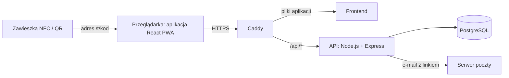

# PeTrace — dokumentacja projektu

Praca inżynierska: **Inteligentny Ekosystem Identyfikacji i Zarządzania Aktywnością Zwierząt Domowych**
Autor: Maciej Strączek, Wyższa Szkoła Turystyki i Ekologii w Suchej Beskidzkiej, rok akademicki 2026/2027

## Problem

Zagubione zwierzę najczęściej znajduje przypadkowa osoba. Zwykła adresówka z numerem telefonu bywa nieczytelna albo nieaktualna, mikroczip wymaga czytnika, którego znalazca nie ma, a rozwiązania oparte na aplikacjach mobilnych wymagają od obcej osoby instalacji programu, zanim w ogóle będzie mogła pomóc. Jednocześnie właściciele nie mają prostego narzędzia, które łączyłoby identyfikację zwierzęcia z codzienną opieką: zapisem karmienia, spacerów i danych zdrowotnych.

## Rozwiązanie

PeTrace to system złożony z fizycznej zawieszki i aplikacji webowej. Zawieszka zawiera tag NFC i kod QR z unikalnym adresem, np. `petrace.pl/t/K7Q2-M9XD`. Zeskanowanie jej dowolnym smartfonem otwiera stronę w przeglądarce, bez instalowania czegokolwiek.

Ten sam adres prowadzi do różnych widoków zależnie od sytuacji (**routing kontekstowy**):

- **znalazca** widzi imię zwierzęcia, uwagi medyczne i może jednym przyciskiem zadzwonić do opiekuna,
- jeśli zwierzę jest oznaczone jako **zaginione**, znalazca dostaje widok alarmowy z komunikatem od opiekuna i możliwością wysłania SMS-a ze swoją lokalizacją,
- **zalogowany właściciel**, skanując zawieszkę własnego zwierzęcia, od razu zapisuje karmienie albo spacer.

W panelu właściciel zarządza profilami zwierząt, włącza tryb zaginięcia, generuje zawieszki i przegląda historię skanowań.

## Najważniejsze założenia

| Założenie | Co oznacza w praktyce |
|---|---|
| Bez instalacji | Znalazca korzysta z przeglądarki. Właściciel może zainstalować aplikację jako PWA, ale nie musi. |
| Prywatność od początku | Poza trybem zaginięcia dane osobowe właściciela nie są wyświetlane. Lokalizacja znalazcy trafia bezpośrednio do SMS-a i nie jest przechowywana w systemie. |
| Decyzje po stronie serwera | O tym, który widok zobaczy osoba skanująca, decyduje serwer. Przeglądarka dostaje tylko dane potrzebne w danym wariancie. |
| Logowanie bez hasła | Właściciel loguje się jednorazowym linkiem wysłanym na e-mail (magic link). |
| Mobile-first | Interfejs projektowany najpierw pod telefon, z dużymi przyciskami dla osoby działającej w stresie. |

## Jak to działa



Szczegóły: [04-architektura.md](04-architektura.md).

## Technologie

| Warstwa | Technologia | Dlaczego |
|---|---|---|
| Interfejs | React 19, Vite | komponentowa budowa interfejsu, szybkie środowisko deweloperskie |
| Wygląd | Tailwind CSS v4 | spójny system kolorów i odstępów zdefiniowany w jednym miejscu |
| Nawigacja | React Router v7 | trasy zagnieżdżone i layouty dla różnych grup użytkowników |
| Aplikacja mobilna | PWA (manifest, service worker) | instalacja z przeglądarki, bez sklepów z aplikacjami |
| Serwer | Node.js, Express | ten sam język po stronie klienta i serwera |
| Baza danych | PostgreSQL | dane silnie powiązane relacjami |
| Wdrożenie | Docker, Caddy, własny VPS | cały system uruchamiany jednym poleceniem, automatyczny HTTPS |

Uzasadnienia wyborów: [05-decyzje.md](05-decyzje.md).

## Struktura repozytorium

```
PeTracker-FinalVersion/
├── client/              # aplikacja webowa (React + Vite)
├── server/              # API (Node.js + Express)
├── docs/                # dokumentacja projektu
├── docker-compose.yml   # uruchomienie całego systemu
└── README.md
```

## Dokumentacja

| Plik | Zawartość |
|---|---|
| [01-zakres.md](01-zakres.md) | zakres funkcjonalny i priorytety |
| [02-przypadki-uzycia.md](02-przypadki-uzycia.md) | aktorzy i scenariusze użycia |
| [03-widoki-i-trasy.md](03-widoki-i-trasy.md) | podstrony aplikacji i ich adresy |
| [04-architektura.md](04-architektura.md) | architektura, baza danych, API, wdrożenie |
| [05-decyzje.md](05-decyzje.md) | dziennik decyzji projektowych |
| [06-harmonogram.md](06-harmonogram.md) | harmonogram, kamienie milowe, ryzyka |
| [07-praca-pisemna.md](07-praca-pisemna.md) | konspekt pracy dyplomowej |
| [08-ankieta.md](08-ankieta.md) | badanie ankietowe (opcjonalne) |
| [09-testy.md](09-testy.md) | scenariusze testów na urządzeniach |

## Stan prac

| Obszar | Stan |
|---|---|
| Frontend: fundamenty, layouty, komponenty UI | ukończone |
| Frontend: warstwa danych i logowanie (mock) | w trakcie |
| Frontend: panel właściciela, strona tagu | zaplanowane |
| Backend i baza danych | zaplanowane |
| Wdrożenie | zaplanowane |
| Praca pisemna | zaplanowana |

Aktualny postęp: [06-harmonogram.md](06-harmonogram.md).
