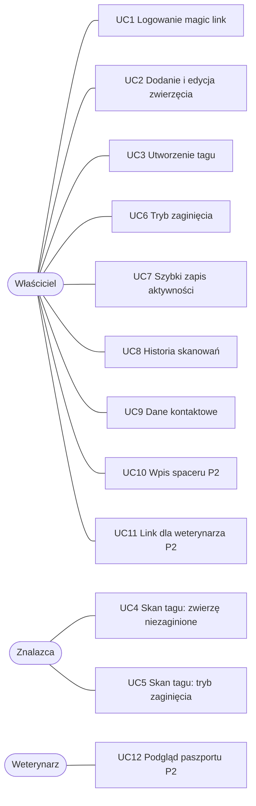

# Przypadki użycia

Zakres zgodny z `01-zakres.md`. Przypadki z priorytetem 2 są oznaczone **(P2)**.
Przypadki użycia stanowią podstawę wymagań funkcjonalnych systemu.

## Aktorzy

| Aktor | Kto to | Konto |
|---|---|---|
| Właściciel | opiekun zwierzęcia | tak (magic link) |
| Znalazca | dowolna osoba, która zeskanowała tag | nie |
| Weterynarz **(P2)** | lekarz, który dostał link od właściciela | nie |
| Serwer poczty | wysyła e-mail z linkiem logowania | — |

## Diagram

---

### UC1 · Logowanie i rejestracja (magic link)
**Aktor:** właściciel
**Scenariusz główny:**
1. Wchodzi na `/login`, wpisuje e-mail (przy pierwszym logowaniu także imię).
2. System wysyła e-mail z jednorazowym linkiem ważnym 15 minut i pokazuje „Sprawdź skrzynkę”.
3. Właściciel klika link, otwiera się `/auth/verify?token=…`.
4. System sprawdza token, tworzy konto, jeśli go nie było, i loguje.
5. Przekierowanie do strony, z której przyszedł, a domyślnie do `/panel`.

**Alternatywy:** token wygasł albo został już użyty → komunikat i przycisk „Wyślij nowy link”. Błędny format e-maila → błąd pod polem.

### UC2 · Dodanie i edycja zwierzęcia
**Aktor:** właściciel (zalogowany)
**Scenariusz główny:**
1. W panelu klika „Dodaj zwierzę”.
2. Wypełnia formularz: imię (wymagane), gatunek, rasa, data urodzenia, waga, uwagi medyczne (choroby, leki, alergie, zachowanie).
3. System zapisuje zwierzę i otwiera jego profil.

**Alternatywy:** brak imienia → błąd walidacji. Edycja działa tak samo z `/zwierzeta/:id/edytuj`.

### UC3 · Utworzenie tagu
**Aktor:** właściciel
**Warunek początkowy:** zwierzę istnieje, właściciel podał numer telefonu (UC9).
**Scenariusz główny:**
1. W profilu zwierzęcia wybiera „Tag” → „Utwórz tag”.
2. System generuje unikalny kod (np. `K7Q2-M9XD`) i pokazuje adres `domena/t/K7Q2-M9XD` oraz kod QR.
3. Właściciel zapisuje adres na tagu NFC aplikacją w telefonie (np. NFC Tools) i drukuje QR.
4. Skanuje tag swoim telefonem i widzi szybki zapis (UC7), co potwierdza, że tag działa.

**Alternatywy:** brak numeru telefonu → system prosi o uzupełnienie w ustawieniach.

### UC4 · Skan tagu przez znalazcę: zwierzę niezaginione
**Aktor:** znalazca
**Scenariusz główny:**
1. Przykłada telefon do tagu albo skanuje QR. Przeglądarka otwiera `/t/:tagId`.
2. System zapisuje skan w historii (UC8).
3. Wyświetla imię zwierzęcia i uwagi medyczne. Dane osobowe właściciela nie są wyświetlane.
4. Znalazca może nacisnąć „Zadzwoń do właściciela”.

**Alternatywy:** kod nie istnieje albo tag jest nieaktywny → „Ten tag nie jest aktywny”.

### UC5 · Skan tagu przez znalazcę: tryb zaginięcia
**Aktor:** znalazca
**Warunek początkowy:** właściciel włączył tryb zaginięcia (UC6).
**Scenariusz główny:**
1. Jak w UC4, kroki 1–2.
2. System pokazuje widok alarmowy: komunikat od właściciela, uwagi medyczne, numer telefonu, przyciski „Zadzwoń” i „Wyślij SMS z lokalizacją”.
3. Po wybraniu SMS przeglądarka prosi o zgodę na lokalizację.
4. Aplikacja buduje link `sms:` z numerem właściciela i treścią zawierającą link do Google Maps.
5. Telefon otwiera aplikację wiadomości z gotowym SMS-em, znalazca go wysyła.

**Alternatywy:** brak zgody na lokalizację → SMS bez linku do mapy, z prośbą o opisanie miejsca. Lokalizacja nie trafia do bazy danych.

### UC6 · Włączenie i wyłączenie trybu zaginięcia
**Aktor:** właściciel
**Scenariusz główny:**
1. W profilu zwierzęcia przestawia przełącznik „Zaginione”.
2. Okno modalne prosi o potwierdzenie i opcjonalny komunikat dla znalazcy.
3. Po potwierdzeniu profil i karta zwierzęcia w panelu dostają czerwone oznaczenie, a strona tagu pokazuje widok z UC5.

**Alternatywy:** wyłączenie trybu zaginięcia też wymaga potwierdzenia.

### UC7 · Szybki zapis aktywności
**Aktor:** właściciel (zalogowany na telefonie)
**Scenariusz główny:**
1. Skanuje tag własnego zwierzęcia.
2. System rozpoznaje właściciela i pokazuje przyciski „Karmienie” i „Spacer”.
3. Kliknięcie zapisuje aktywność z aktualną godziną i pokazuje potwierdzenie.

**Alternatywy:** zalogowany użytkownik, który nie jest właścicielem → widok znalazcy (UC4 albo UC5).

### UC8 · Historia skanowań (audyt)
**Aktor:** właściciel
**Scenariusz główny:** w zakładce „Tag” albo w panelu widzi listę skanowań: data, godzina, przeglądarka i system, informacja, czy skanował sam właściciel.

### UC9 · Dane kontaktowe i wylogowanie
**Aktor:** właściciel
**Scenariusz główny:** w `/ustawienia` uzupełnia imię i numer telefonu używany w UC4 i UC5. Przycisk „Wyloguj się” kończy sesję i przenosi na `/`.

### UC10 · Ręczny wpis spaceru (P2)
**Aktor:** właściciel
**Scenariusz główny:** w `/spacery/nowy` wybiera zwierzę, datę, czas trwania i opcjonalnie dystans. Lista `/spacery` pokazuje wpisy i sumę czasu z ostatnich 7 dni.

### UC11 · Link dla weterynarza (P2)
**Aktor:** właściciel
**Scenariusz główny:** w profilu zwierzęcia tworzy link z czasem ważności (np. 24 h), dostaje kod QR do pokazania lekarzowi. Może unieważnić link przed czasem.

### UC12 · Podgląd paszportu medycznego (P2)
**Aktor:** weterynarz
**Scenariusz główny:** skanuje QR, widzi dane medyczne zwierzęcia tylko do odczytu i czas ważności linku.
**Alternatywy:** link wygasł albo unieważniony → „Link wygasł”.
