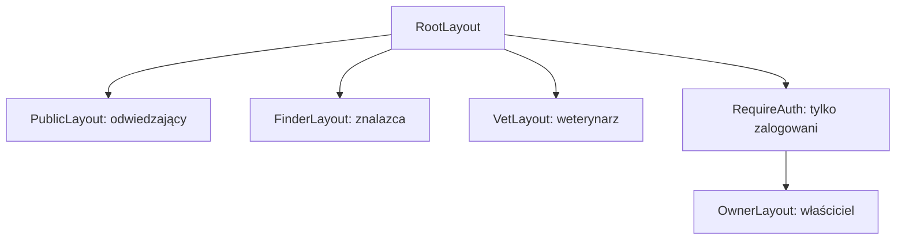

# Widoki i trasy

Lista wszystkich podstron aplikacji. Priorytety według [01-zakres.md](01-zakres.md).

Strony są pogrupowane według layoutu, czyli wspólnej ramy (nagłówek, nawigacja), w której się wyświetlają. Każda grupa odpowiada innej grupie użytkowników.

## Strony publiczne

| Adres | Strona | Priorytet |
|---|---|---|
| `/` | strona główna: czym jest PeTrace, jak działa w trzech krokach, logowanie | 1 |
| `/login` | formularz adresu e-mail | 1 |
| `/login/sprawdz-poczte` | informacja o wysłanym linku | 1 |
| `/auth/verify` | weryfikacja tokenu z linku i zalogowanie | 1 |
| `*` | strona 404 | 1 |

## Znalazca

Wąska kolumna, bez nawigacji i zbędnych elementów, duże przyciski.

| Adres | Strona | Priorytet |
|---|---|---|
| `/t/:tagId` | strona zawieszki z routingiem kontekstowym | 1 |
| `/t/:tagId/lokalizacja` | pobranie pozycji GPS i wysłanie SMS-a z lokalizacją | 1 |

### Routing kontekstowy `/t/:tagId`

Warunki sprawdzane są po kolei, pierwszy spełniony decyduje o widoku.

| Kolejność | Warunek | Widok |
|---|---|---|
| 1 | kod nie istnieje albo zawieszka nie jest przypisana | „Ten tag nie jest aktywny” |
| 2 | skanuje zalogowany właściciel zwierzęcia | szybki zapis: „Karmienie”, „Spacer” |
| 3 | zwierzę ma włączony tryb zaginięcia | widok alarmowy: komunikat, telefon, SMS z lokalizacją |
| 4 | pozostałe przypadki | profil podstawowy, dane właściciela niewidoczne, przycisk „Zadzwoń” |

Warunek 2 jest przed 3, aby właściciel, który odnalazł zwierzę, po zeskanowaniu zawieszki zobaczył swój widok, a nie alarm przeznaczony dla znalazców.

Każde wejście na stronę zawieszki jest zapisywane w historii skanowań.

## Weterynarz

| Adres | Strona | Priorytet |
|---|---|---|
| `/vet/:shareToken` | paszport medyczny tylko do odczytu, komunikat po wygaśnięciu linku | 2 |

## Właściciel

Wymaga zalogowania. Na telefonie dolna nawigacja i górny pasek, na komputerze boczny panel.

| Adres | Strona | Priorytet |
|---|---|---|
| `/panel` | lista zwierząt i ostatnie skanowania | 1 |
| `/zwierzeta/nowe` | formularz nowego zwierzęcia | 1 |
| `/zwierzeta/:id` | profil: dane, zdrowie, aktywność, przełącznik trybu zaginięcia | 1 |
| `/zwierzeta/:id/edytuj` | edycja profilu | 1 |
| `/zwierzeta/:id/tag` | zawieszka: generowanie kodu, QR, adres NFC, historia skanowań | 1 |
| `/zwierzeta/:id/vet-share` | tworzenie i unieważnianie linku dla weterynarza | 2 |
| `/spacery` | lista spacerów i podsumowanie z 7 dni | 2 |
| `/spacery/nowy` | ręczny wpis spaceru | 2 |
| `/harmonogram` | lista przypomnień | 3 |
| `/ustawienia` | imię, numer telefonu dla znalazców, wylogowanie | 1 |

## Strony pomocnicze

| Adres | Strona |
|---|---|
| `/dev/ui` | galeria komponentów interfejsu, dostępna tylko w trybie deweloperskim |
