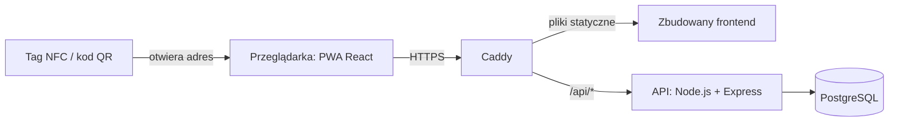
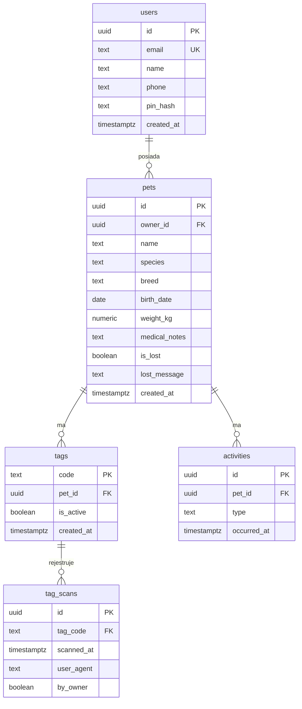
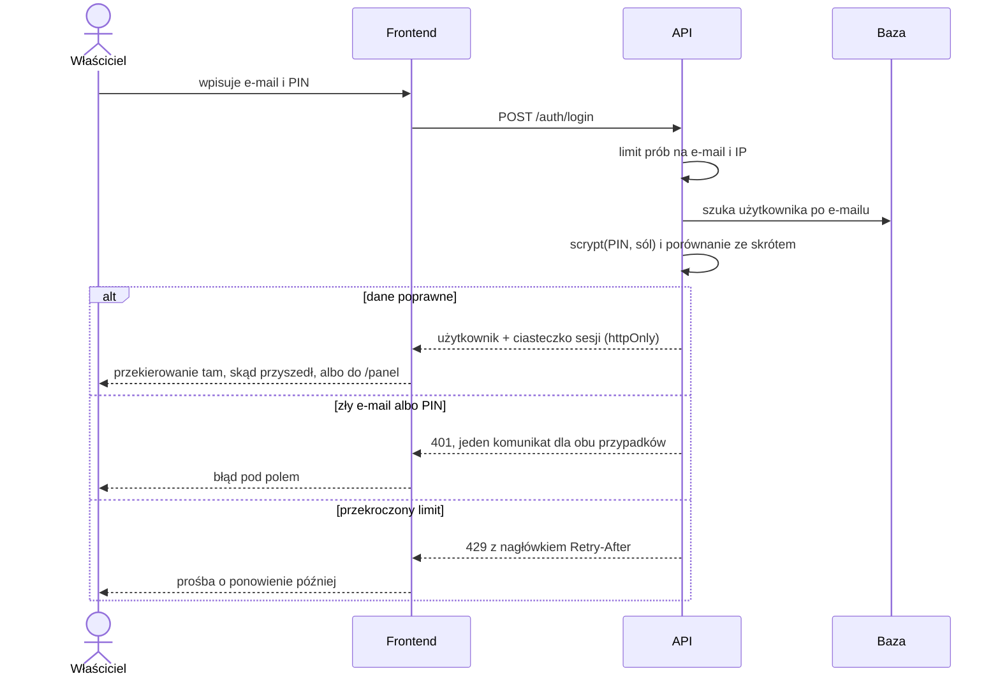
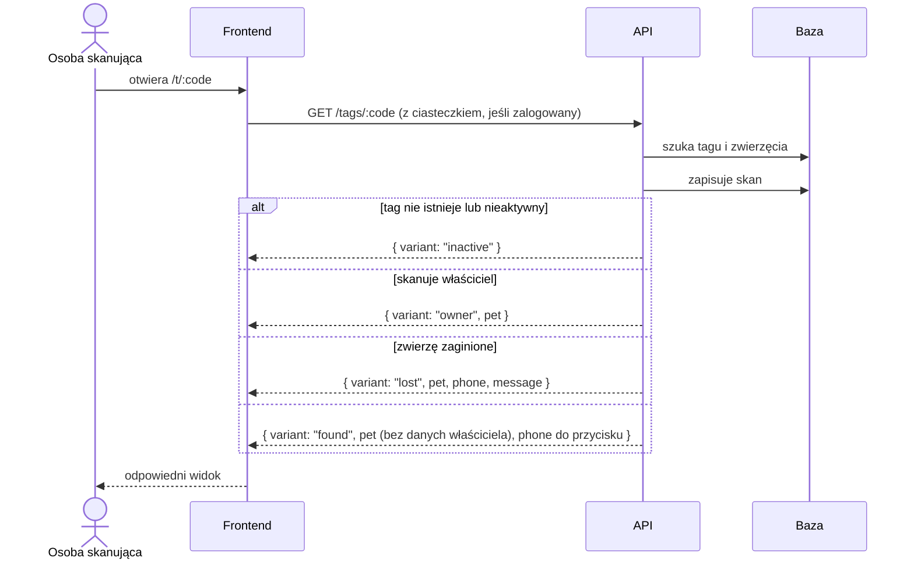
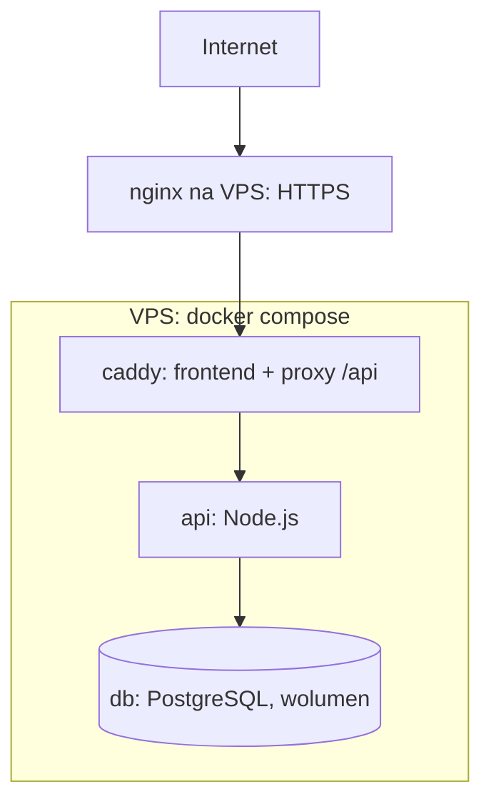

# Architektura

> **Status:** interfejs w realizacji, serwer i baza danych w realizacji, wdrożenie zaprojektowane.

## Przegląd



Wszystko działa pod jedną domeną: Caddy serwuje frontend i przekazuje adresy `/api/*` do Expressa. Dzięki temu nie ma problemów z CORS, a ciasteczko sesji działa bez dodatkowej konfiguracji.

## Struktura repozytorium (docelowa)

```
PeTracker-FinalVersion/
├── client/                 # aplikacja webowa Vite + React
├── server/                 # backend Express
├── plan/                   # ta dokumentacja
├── docker-compose.yml      # cały system
├── docker-compose.dev.yml  # sama baza do pracy lokalnej
└── README.md
```

## Frontend (`client/`)

Warstwy, od góry:

```
pages  →  components  →  hooks / context  →  api  →  fetch /api
```

- **pages**: jedna strona na trasę, składa komponenty i pobiera dane przez hooki.
- **components**: `layout/` (ramy stron), `ui/` (wspólne klocki), komponenty domenowe (`pets/`, `finder/`, `tags/`).
- **hooks / context**: `useAuth` (zalogowany użytkownik), `useAsync` (ładowanie danych), `useGeolocation`.
- **api**: jedyne miejsce, które wie, skąd przychodzą dane. `request.js` wykonuje zapytania `fetch`, a `auth.js`, `pets.js`, `tags.js` i `activities.js` podają metodę, adres i dane.

## Backend (`server/`)

```
server/
├── src/
│   ├── index.js            # start serwera
│   ├── app.js              # konfiguracja Expressa, podpięcie tras
│   ├── config.js           # zmienne środowiskowe
│   ├── db.js               # połączenie z PostgreSQL (pg.Pool)
│   ├── errors.js           # HttpError
│   ├── mappers.js          # snake_case z bazy → camelCase w API
│   ├── validation.js       # sprawdzanie danych wejściowych
│   ├── seed.js             # dane przykładowe przy pustej bazie
│   ├── routes/             # auth.js, me.js, pets.js, tags.js, activities.js
│   ├── middleware/         # requireAuth.js, rateLimit.js, errorHandler.js
│   └── services/           # pin.js (skrót PIN-u), session.js (JWT), pets.js, tagCodes.js
├── sql/
│   ├── 001_init.sql        # schemat bazy
│   └── seed.sql            # dane przykładowe
├── scripts/db-reset.js
├── Dockerfile
└── package.json
```

Biblioteki: `express`, `pg`, `jsonwebtoken`, `cookie-parser`, `dotenv`. Skrót PIN-u liczy wbudowany moduł `node:crypto`. Bez ORM-a: zapytania SQL pisane ręcznie, co jest prostsze przy kilku tabelach i dobrze się opisuje w pracy.

## Baza danych



Uwagi:
- `activities.type`: `feeding` albo `walk`.
- Częściowy indeks unikalny na `tags (pet_id) WHERE is_active`: zwierzę ma najwyżej jeden aktywny tag. `is_active` zostawia miejsce na wymianę kodu (priorytet 2).
- `users.pin_hash` ma postać `sól:skrót` i powstaje funkcją `scrypt`. PIN nigdy nie jest zapisywany ani zwracany przez API.
- Zdjęcia zwierząt: priorytet 2 (wymaga przechowywania plików). Do tego czasu awatar to ikona gatunku.

## API

Wszystkie adresy zaczynają się od `/api`. 🔒 = wymaga zalogowania.

### Konto i logowanie
| Metoda | Adres | Co robi | Funkcja w `client/src/api` |
|---|---|---|---|
| POST | `/auth/register` | zakłada konto, ustawia ciasteczko sesji | `register` |
| POST | `/auth/login` | sprawdza e-mail i PIN, ustawia ciasteczko sesji | `login` |
| GET | `/auth/me` | zalogowany użytkownik albo `{ user: null }` | `getCurrentUser` |
| POST | `/auth/logout` | usuwa ciasteczko | `logout` |
| GET | `/auth/demo` | czy logowanie na konto demo jest włączone | `getDemoLogin` |
| POST | `/auth/demo` | loguje na konto demo, gdy jest włączone | `loginAsDemo` |
| PATCH | `/me` 🔒 | zmienia imię i telefon | `updateSettings` |

### Zwierzęta
| Metoda | Adres | Co robi | Funkcja |
|---|---|---|---|
| GET | `/pets` 🔒 | lista zwierząt właściciela | `getPets` |
| POST | `/pets` 🔒 | dodaje zwierzę | `createPet` |
| GET | `/pets/:id` 🔒 | szczegóły zwierzęcia | `getPetById` |
| PATCH | `/pets/:id` 🔒 | edycja | `updatePet` |
| PATCH | `/pets/:id/lost` 🔒 | włącza lub wyłącza tryb zaginięcia | `setLostMode` |

### Tagi i skanowania
| Metoda | Adres | Co robi | Funkcja |
|---|---|---|---|
| POST | `/pets/:id/tag` 🔒 | generuje kod tagu | `createTag` |
| GET | `/pets/:id/scans` 🔒 | historia skanowań | `getTagScans` |
| GET | `/tags/:code` | **publiczny**: rozpoznaje wariant widoku, zapisuje skan, zwraca tylko dozwolone dane | `resolveTag` |

### Aktywności
| Metoda | Adres | Co robi | Funkcja |
|---|---|---|---|
| POST | `/pets/:id/activities` 🔒 | szybki zapis aktywności | `logActivity` |
| GET | `/pets/:id/activities?days=7` 🔒 | lista aktywności | `getActivities` |

### Pomocnicze
| Metoda | Adres | Co robi |
|---|---|---|
| GET | `/health` | sprawdzenie, czy serwer działa |

## Najważniejsze przepływy

### Logowanie PIN-em



### Skan tagu (routing kontekstowy)



Decyzja o wariancie zapada **na serwerze**, nie w przeglądarce. Dzięki temu dane, których dany wariant nie potrzebuje, w ogóle nie opuszczają serwera.

## Bezpieczeństwo (minimum)

- PIN: skrót `scrypt` z losową solą dla każdego użytkownika i porównanie w stałym czasie (`timingSafeEqual`).
- Limit prób logowania: 5 na e-mail i 20 na IP w 15 minut. Limit rejestracji: 10 na IP. Komunikat błędu nie ujawnia, czy konto istnieje.
- Sesja: podpisany JWT w ciasteczku `httpOnly`, `Secure`, `SameSite=Lax`.
- Każdy endpoint 🔒 sprawdza, czy zwierzę należy do zalogowanego użytkownika. Cudze zwierzę daje 404.
- Kod tagu: 8 losowych znaków bez mylących (`0/O`, `1/I/L`), praktycznie nie do zgadnięcia.
- SQL zawsze z parametrami (`$1`), bez sklejania zapytań z danymi.
- Tylko HTTPS (wymagane też przez geolokalizację i service worker).

**Ograniczenia:** 6-cyfrowy PIN to milion kombinacji, więc po wycieku bazy skróty da się złamać. Adres e-mail nie jest potwierdzany, a PIN resetuje administrator. Szczegóły: [D21](05-decyzje.md).

## Wdrożenie



- `db`: obraz `postgres`, dane na wolumenie, `sql/001_init.sql` uruchamiany przy pierwszym starcie.
- `api`: obraz z `server/Dockerfile`, konfiguracja w zmiennych środowiskowych (`.env` poza repozytorium).
- `caddy`: serwuje `client/dist` i przekazuje `/api/*`. Na serwerze bez innych usług sam obsługuje HTTPS, a na współdzielonym VPS stoi za nginx ([D25](05-decyzje.md)).
- Kolejność: cały system wdrażany jest po logowaniu i panelu właściciela, przed widokami znalazcy ([D24](05-decyzje.md)).
