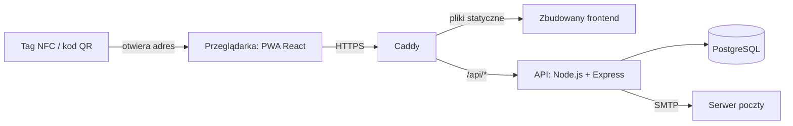
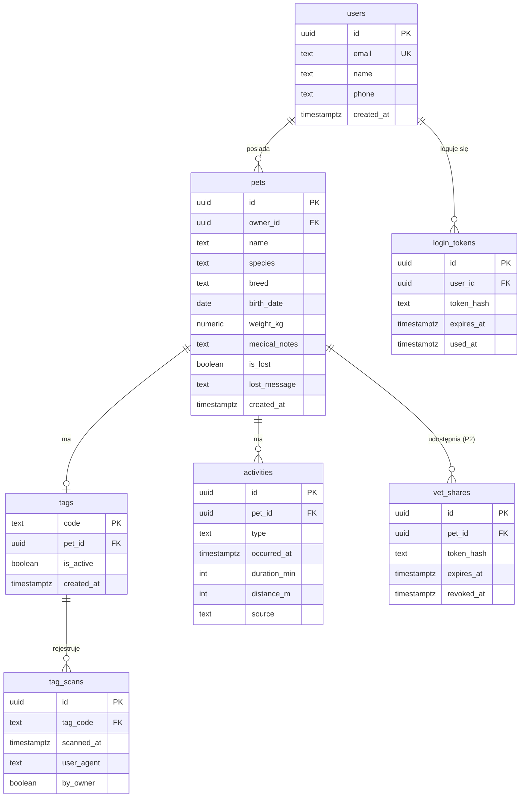
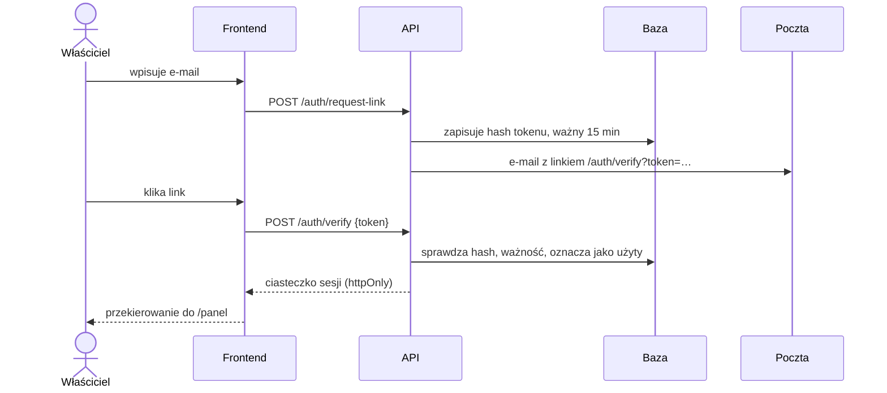
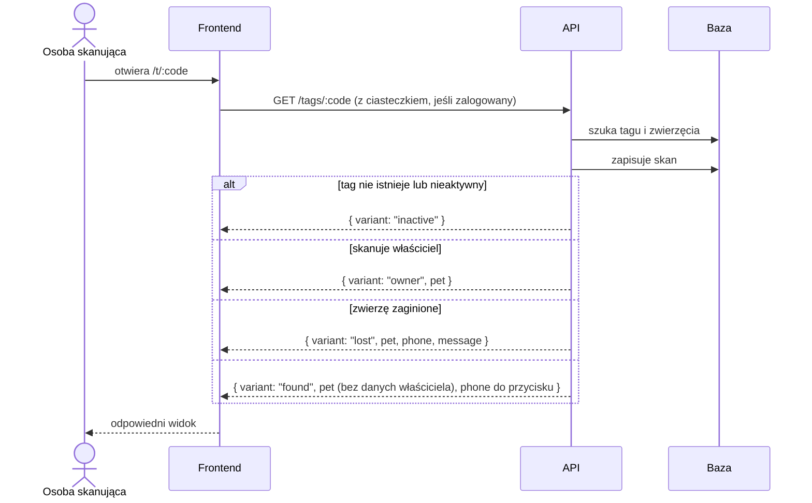
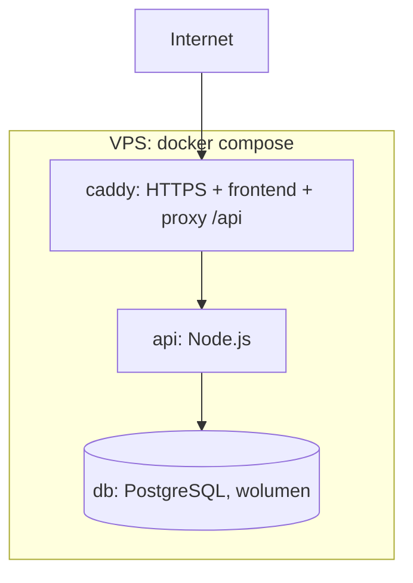

# Architektura

> **Status:** frontend w realizacji, backend i wdrożenie zaprojektowane.

## Przegląd



Wszystko działa pod jedną domeną: Caddy serwuje frontend i przekazuje adresy `/api/*` do Expressa. Dzięki temu nie ma problemów z CORS, a ciasteczko sesji działa bez dodatkowej konfiguracji.

## Struktura repozytorium (docelowa)

```
PeTracker-FinalVersion/
├── client/                 # aplikacja webowa Vite + React
├── server/                 # backend Express
├── docs/                   # ta dokumentacja
├── docker-compose.yml
└── README.md
```

## Frontend (`client/`)

Warstwy, od góry:

```
pages  →  components  →  hooks / context  →  api  →  mocks (etap budowy) | fetch /api (docelowo)
```

- **pages**: jedna strona na trasę, składa komponenty i pobiera dane przez hooki.
- **components**: `layout/` (ramy stron), `ui/` (wspólne klocki), komponenty domenowe (`pets/`, `finder/`).
- **hooks / context**: `useAuth` (zalogowany użytkownik), `useAsync` (ładowanie danych).
- **api**: jedyne miejsce, które wie, skąd przychodzą dane. Na etapie budowy interfejsu korzysta z danych przykładowych w `localStorage` (`mocks/`), docelowo z zapytań `fetch` do API. Zmiana źródła danych dotyczy tylko tego folderu.

## Backend (`server/`)

```
server/
├── src/
│   ├── index.js            # start serwera
│   ├── app.js              # konfiguracja Expressa, podpięcie tras
│   ├── db.js               # połączenie z PostgreSQL (pg.Pool)
│   ├── routes/             # auth.js, me.js, pets.js, tags.js, activities.js
│   ├── middleware/         # requireAuth.js, errorHandler.js
│   └── services/           # mail.js (wysyłka linku), tokens.js (generowanie i hashowanie)
├── sql/
│   └── 001_init.sql        # schemat bazy
├── Dockerfile
└── package.json
```

Biblioteki: `express`, `pg`, `nodemailer`, `jsonwebtoken`, `cookie-parser`, `dotenv`. Bez ORM-a: zapytania SQL pisane ręcznie, co jest prostsze przy kilku tabelach i dobrze się opisuje w pracy.

## Baza danych



Uwagi:
- `activities.type`: `feeding` albo `walk`; `source`: `quick_tap` (po skanie) albo `manual` (formularz).
- `tags.pet_id` jest unikalne: jedno zwierzę ma jeden aktywny tag.
- Tokeny (`login_tokens`, `vet_shares`) są przechowywane jako hash SHA-256, nigdy w czystej postaci.
- Zdjęcia zwierząt: priorytet 2 (wymaga przechowywania plików). Do tego czasu awatar z inicjałami.

## API

Wszystkie adresy zaczynają się od `/api`. 🔒 = wymaga zalogowania.

### Logowanie
| Metoda | Adres | Co robi | Funkcja w `client/src/api` |
|---|---|---|---|
| POST | `/auth/request-link` | tworzy token, wysyła e-mail | `requestMagicLink` |
| POST | `/auth/verify` | sprawdza token, ustawia ciasteczko sesji | `verifyToken` |
| GET | `/auth/me` 🔒 | zwraca zalogowanego użytkownika | `getCurrentUser` |
| POST | `/auth/logout` 🔒 | usuwa ciasteczko | `logout` |
| PATCH | `/me` 🔒 | zmienia imię i telefon | `updateSettings` |

### Zwierzęta
| Metoda | Adres | Co robi | Funkcja |
|---|---|---|---|
| GET | `/pets` 🔒 | lista zwierząt właściciela | `getPets` |
| POST | `/pets` 🔒 | dodaje zwierzę | `createPet` |
| GET | `/pets/:id` 🔒 | szczegóły zwierzęcia | `getPetById` |
| PATCH | `/pets/:id` 🔒 | edycja | `updatePet` |
| PATCH | `/pets/:id/lost` 🔒 | włącza lub wyłącza tryb zaginięcia | `setLostMode` |

### Tagi i skanowania
| Metoda | Adres | Co robi | Funkcja |
|---|---|---|---|
| POST | `/pets/:id/tag` 🔒 | generuje kod tagu | `createTag` |
| GET | `/pets/:id/scans` 🔒 | historia skanowań | `getTagScans` |
| GET | `/tags/:code` | **publiczny**: rozpoznaje wariant widoku, zapisuje skan, zwraca tylko dozwolone dane | `resolveTag` |

### Aktywności
| Metoda | Adres | Co robi | Funkcja |
|---|---|---|---|
| POST | `/pets/:id/activities` 🔒 | zapis aktywności (szybki albo ręczny) | `logActivity` |
| GET | `/pets/:id/activities?days=7` 🔒 | lista aktywności | `getActivities` |

### Weterynarz (P2)
| Metoda | Adres | Co robi |
|---|---|---|
| POST | `/pets/:id/vet-shares` 🔒 | tworzy link z czasem ważności |
| DELETE | `/vet-shares/:id` 🔒 | unieważnia link |
| GET | `/vet/:token` | **publiczny**: dane medyczne, jeśli link ważny |

## Najważniejsze przepływy

### Logowanie magic link



### Skan tagu (routing kontekstowy)



Decyzja o wariancie zapada **na serwerze**, nie w przeglądarce. Dzięki temu dane, których dany wariant nie potrzebuje, w ogóle nie opuszczają serwera.

## Bezpieczeństwo (minimum)

- Tokeny losowe (`crypto.randomBytes`), w bazie tylko hash, link logowania jednorazowy i ważny 15 minut.
- Sesja: podpisany JWT w ciasteczku `httpOnly`, `Secure`, `SameSite=Lax`.
- Ograniczenie liczby żądań na `/auth/request-link` (ochrona przed zasypaniem skrzynki).
- Każdy endpoint 🔒 sprawdza, czy zwierzę należy do zalogowanego użytkownika.
- Kod tagu: 8 losowych znaków bez mylących (`0/O`, `1/I`), ok. 10¹² kombinacji, praktycznie nie do zgadnięcia.
- Tylko HTTPS (wymagane też przez geolokalizację i service worker).

## Wdrożenie



- `db`: obraz `postgres`, dane na wolumenie, `sql/001_init.sql` uruchamiany przy pierwszym starcie.
- `api`: obraz z `server/Dockerfile`, konfiguracja w zmiennych środowiskowych (`.env` poza repozytorium).
- `caddy`: serwuje `client/dist` i automatycznie pobiera certyfikat Let’s Encrypt dla domeny.
- Kolejność: najpierw sam frontend na danych przykładowych, następnie usługi `api` i `db`.
