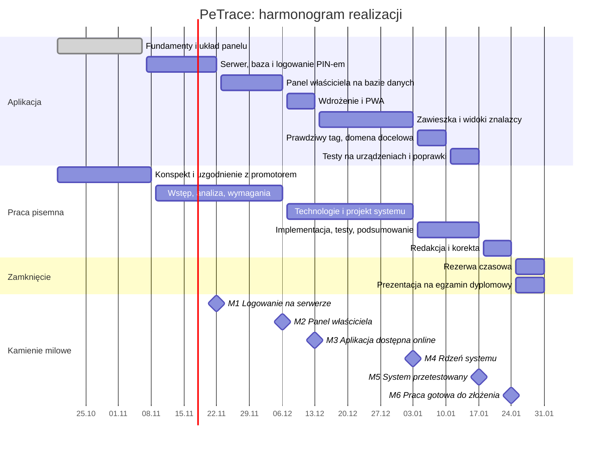

# Harmonogram

Plan realizacji od 19 października 2026 do złożenia pracy, zaktualizowany 6 listopada 2026 po zmianie zakresu ([01-zakres.md](01-zakres.md)). Prace nad aplikacją i pracą pisemną prowadzone są równolegle: rozdziały opisowe powstają w trakcie implementacji, a nie po jej zakończeniu.

> Termin złożenia pracy w systemie uczelni: **do potwierdzenia z promotorem** (zakładany: koniec stycznia 2027).

## Oś czasu

## Kamienie milowe

| Nr | Data | Kamień milowy | Jak sprawdzić, że jest osiągnięty |
|---|---|---|---|
| M1 | 22.11.2026 | Logowanie na serwerze | konto i logowanie PIN-em na PostgreSQL, limit prób, ochrona tras panelu, powrót na stronę sprzed logowania |
| M2 | 6.12.2026 | Panel właściciela | dodanie, edycja i profil zwierzęcia na bazie danych, ustawienia, brak kodu mock w projekcie |
| M3 | 13.12.2026 | Aplikacja dostępna online | wersja pod własną domeną przez HTTPS w Docker Compose, instalacja jako PWA |
| M4 | 3.01.2027 | Rdzeń systemu | cztery warianty strony zawieszki, tryb zaginięcia, SMS z lokalizacją, zawieszka z QR, historia skanowań |
| M5 | 17.01.2027 | System przetestowany | prawdziwy tag NFC i wydrukowany QR, domena docelowa, wypełniona tabela testów, Lighthouse |
| M6 | 24.01.2027 | Praca gotowa do złożenia | komplet rozdziałów, korekta, zgodność z wymaganiami redakcyjnymi uczelni |

Konsultacje z promotorem planowane są **przed rozpoczęciem logowania PIN-em (zmiana zakresu)**, po kamieniach M1, M3, M5 i przed M6.

Szczegółowa lista sesji: `PLAN_PRZEPISYWANIA.md` oraz [plan w HTML](PeTrace%20—%20plan%20przepisywania.html).

## Zadania

### Etap 1 · Fundamenty i układ panelu (19.10–6.11)
- [x] Projekt Vite + React, konfiguracja Tailwind i tokenów kolorów
- [x] Routing i mapa tras
- [x] Layouty oraz komponenty interfejsu: Card, Badge, Spinner, Button, Input, Textarea, Select, Toggle, Tabs, Modal, Sheet
- [x] Lista zwierząt, ekran jednego zwierzęcia, przełącznik i arkusz „Akcje”
- [x] Hook `useAsync` (stany ładowania, błędu, danych)

### Etap 2 · Serwer, baza i logowanie PIN-em (7.11–22.11)
- [ ] Usunięcie spacerów, harmonogramu i weterynarza, przeniesienie aplikacji do `client/`
- [ ] Szkielet `server/`: Express, połączenie z bazą, obsługa błędów
- [ ] Schemat bazy `sql/001_init.sql` i dane przykładowe `sql/seed.sql`
- [ ] Rejestracja i logowanie: skrót `scrypt`, limit prób, ciasteczko sesji
- [ ] Kontekst logowania i hook `useAuth`, formularze logowania i rejestracji
- [ ] Ochrona tras panelu, wylogowanie, konto demo

### Etap 3 · Panel właściciela (23.11–6.12)
- [ ] Middleware `requireAuth`, sprawdzanie, czy zasób należy do zalogowanego użytkownika
- [ ] Zwierzęta z bazy danych, usunięcie warstwy mock
- [ ] Profil z zakładkami, formularz dodawania i edycji
- [ ] Ustawienia: imię, numer telefonu

### Etap 4 · Wdrożenie i PWA (7.12–13.12)
- [ ] `docker-compose.yml` z usługami `caddy`, `api`, `db`
- [ ] VPS, domena, HTTPS, zmienne środowiskowe
- [ ] Manifest, ikony 192 i 512 px oraz maskable, service worker

### Etap 5 · Zawieszka i widoki znalazcy (14.12–3.01)
- [ ] Publiczny `GET /tags/:code` z wyborem wariantu i strona `/t/:tagId`
- [ ] Widoki: nieaktywny tag, znalazca, zaginione, szybki zapis właściciela
- [ ] Przełącznik trybu zaginięcia z potwierdzeniem
- [ ] Hook geolokalizacji, strona wysyłania SMS z lokalizacją
- [ ] Zapis aktywności i lista z 7 dni
- [ ] Generowanie zawieszki, kod QR, zapis skanów i ich historia

### Etap 6 · Prawdziwy tag i domena docelowa (4.01–10.01)
- [ ] Zapisanie adresu na tagach NFC, wydruk kodów QR
- [ ] Przełączenie `petracker.pl` na wersję docelową

### Etap 7 · Testy i poprawki (11.01–17.01)
- [ ] Pełna seria testów na urządzeniach ([09-testy.md](09-testy.md))
- [ ] Przegląd dostępności (Lighthouse, obsługa klawiaturą)
- [ ] Poprawki błędów, zrzuty ekranu do pracy
- [ ] Funkcje priorytetu 2, jeśli pozostał czas

## Ryzyka

| Ryzyko | Skutek | Jak ograniczamy |
|---|---|---|
| Opóźnienia w realizacji | brak czasu na pracę pisemną | mniejszy zakres, rezerwa w ostatnim tygodniu, rozdziały pisane równolegle |
| Nauka backendu równolegle z interfejsem | blokada pracy nad ekranami przez problem na serwerze | małe sesje testowane `curl`-em, działający prototyp jako wzór |
| Promotor nie akceptuje zmiany logowania lub zakresu | konieczność przywrócenia funkcji | konsultacja przed rozpoczęciem logowania PIN-em; wersja z magic linkiem jest w historii gita prototypu |
| Zapomniany PIN | właściciel nie ma dostępu do konta | reset przez administratora, ograniczenie opisane w pracy |
| Odgadnięcie PIN-u | dostęp do cudzego konta | limit prób, skrót `scrypt`, ograniczenie opisane w pracy |
| Różnice w obsłudze `sms:` na Androidzie i iOS | niepoprawna treść wiadomości | testy na obu systemach, osobna składnia linku zależnie od systemu |
| Odmowa dostępu do lokalizacji | znalazca nie wyśle pozycji | SMS bez linku do mapy z prośbą o opis miejsca, nadal dostępny przycisk „Zadzwoń” |
| Odczyt NFC na starszych telefonach | zawieszka nie otwiera strony | kod QR na tej samej zawieszce |
| Problemy z domeną lub HTTPS | geolokalizacja i PWA nie działają | wdrożenie już na M3, przed widokami znalazcy |
| Utrata danych na serwerze | utrata danych testowych | dane na wolumenie Dockera, zrzut bazy (`pg_dump`), jeśli pozwoli czas |

## Definicja ukończenia funkcji

Funkcja jest ukończona, gdy:

1. działa w przeglądarce bez błędów w konsoli,
2. `npm run lint` i `npm run build` kończą się bez błędów,
3. działa na telefonie i na komputerze,
4. obsługuje stan ładowania, błąd i brak danych,
5. jest opisana w README lub dokumentacji, jeśli zmienia strukturę albo trasy,
6. jest zapisana w repozytorium osobnym commitem z opisem zmiany.
