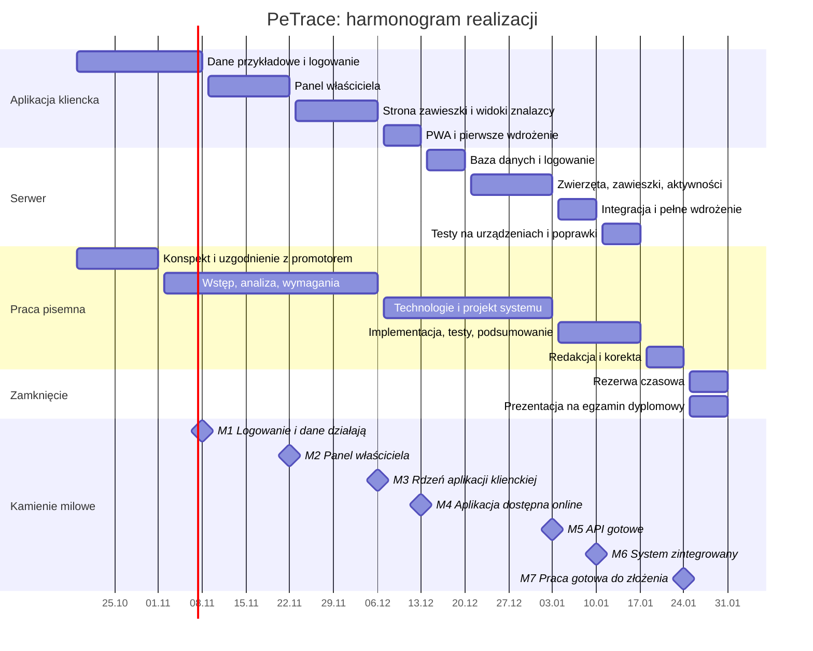

# Harmonogram

Plan realizacji od 19 października 2026 do złożenia pracy. Prace nad aplikacją i pracą pisemną prowadzone są równolegle: rozdziały opisowe powstają w trakcie implementacji, a nie po jej zakończeniu.

> Termin złożenia pracy w systemie uczelni: **do potwierdzenia z promotorem** (zakładany: koniec stycznia 2027).

## Oś czasu

## Kamienie milowe

| Nr | Data | Kamień milowy | Jak sprawdzić, że jest osiągnięty |
|---|---|---|---|
| M1 | 8.11.2026 | Logowanie i dane działają | logowanie magic link na danych przykładowych, ochrona tras panelu, powrót na stronę sprzed logowania |
| M2 | 22.11.2026 | Panel właściciela | dodanie, edycja i profil zwierzęcia; zmiany zachowane po odświeżeniu |
| M3 | 6.12.2026 | Rdzeń aplikacji klienckiej | cztery warianty strony zawieszki, tryb zaginięcia, SMS z lokalizacją, generowanie zawieszki i QR |
| M4 | 13.12.2026 | Aplikacja dostępna online | wersja pod własną domeną przez HTTPS, instalacja jako PWA, skan prawdziwej zawieszki telefonem |
| M5 | 3.01.2027 | API gotowe | wszystkie endpointy priorytetu 1 działają na bazie PostgreSQL, wysyłka maili z linkiem |
| M6 | 10.01.2027 | System zintegrowany | aplikacja kliencka korzysta z API zamiast danych przykładowych, całość uruchamiana przez `docker compose` |
| M7 | 24.01.2027 | Praca gotowa do złożenia | komplet rozdziałów, korekta, zgodność z wymaganiami redakcyjnymi uczelni |

Konsultacje z promotorem planowane są po kamieniach M1, M3, M6 i przed M7.

## Zadania

### Etap 1 · Dane przykładowe i logowanie (19.10–8.11)
- [x] Projekt Vite + React, konfiguracja Tailwind i tokenów kolorów
- [x] Routing i mapa wszystkich tras
- [x] Layouty: główny, publiczny, znalazcy, weterynarza, właściciela; nawigacja boczna i dolna
- [x] Komponenty interfejsu: Card, Badge, Spinner, Button, Input, Textarea, Select, Toggle, Tabs, Modal
- [x] Dane przykładowe (`mocks/seed.js`)
- [ ] Baza w `localStorage` z symulowanym opóźnieniem odpowiedzi
- [ ] Moduły `api/`: zwierzęta, logowanie
- [ ] Kontekst logowania i hook `useAuth`
- [ ] Hook `useAsync` (stany ładowania, błędu, danych)
- [ ] Ochrona tras panelu
- [ ] Formularz logowania, weryfikacja linku, wylogowanie

### Etap 2 · Panel właściciela (9.11–22.11)
- [ ] Funkcje formatowania dat i czasu (`lib/format.js`)
- [ ] Awatar i karta zwierzęcia, oznaczenie zaginięcia
- [ ] Panel: lista zwierząt i ostatnie skanowania
- [ ] Profil zwierzęcia z zakładkami (dane, zdrowie, aktywność)
- [ ] Formularz dodawania i edycji zwierzęcia
- [ ] Ustawienia: imię, numer telefonu, wylogowanie

### Etap 3 · Strona zawieszki i widoki znalazcy (23.11–6.12)
- [ ] `resolveTag`: wybór wariantu i zapis skanowania
- [ ] Strona `/t/:tagId` z czterema wariantami
- [ ] Widoki: nieaktywny tag, znalazca, zaginione, szybki zapis właściciela
- [ ] Hook geolokalizacji, strona wysyłania SMS z lokalizacją
- [ ] Przełącznik trybu zaginięcia z potwierdzeniem
- [ ] Generowanie zawieszki, kod QR, historia skanowań

### Etap 4 · PWA i pierwsze wdrożenie (7.12–13.12)
- [ ] Manifest, ikony 192 i 512 px oraz maskable, service worker
- [ ] Przeniesienie aplikacji do folderu `client/`
- [ ] Docker i Caddy na VPS, konfiguracja domeny, HTTPS
- [ ] Zapisanie adresu na tagach NFC, wydruk kodów QR
- [ ] Pierwsza seria testów na telefonach ([09-testy.md](09-testy.md))

### Etap 5 · Baza danych i logowanie (14.12–20.12)
- [ ] Szkielet `server/`: Express, połączenie z bazą, obsługa błędów
- [ ] Schemat bazy `sql/001_init.sql`
- [ ] Wysyłka maili (SMTP), endpointy logowania, ciasteczko sesji
- [ ] Middleware `requireAuth`, ograniczenie liczby żądań logowania

### Etap 6 · Zwierzęta, zawieszki, aktywności (21.12–3.01)
- [ ] Endpointy zwierząt i trybu zaginięcia
- [ ] Endpointy zawieszek, publiczny `GET /tags/:code` z wyborem wariantu
- [ ] Endpointy aktywności i historii skanowań
- [ ] Sprawdzanie, czy zasób należy do zalogowanego użytkownika

### Etap 7 · Integracja i pełne wdrożenie (4.01–10.01)
- [ ] Moduły `api/` przełączone na `fetch` do serwera
- [ ] `docker-compose.yml` z usługami `caddy`, `api`, `db`
- [ ] Zmienne środowiskowe i kopia zapasowa bazy
- [ ] Funkcje priorytetu 2, jeśli pozostał czas

### Etap 8 · Testy i poprawki (11.01–17.01)
- [ ] Pełna seria testów na urządzeniach
- [ ] Przegląd dostępności (Lighthouse, obsługa klawiaturą)
- [ ] Poprawki błędów, zrzuty ekranu do pracy

## Ryzyka

| Ryzyko | Skutek | Jak ograniczamy |
|---|---|---|
| Opóźnienia w realizacji | brak czasu na pracę pisemną | priorytety zakresu, rezerwa w ostatnim tygodniu, rozdziały pisane równolegle |
| Maile z linkiem trafiają do spamu | brak możliwości zalogowania | dostawca poczty transakcyjnej z konfiguracją SPF i DKIM; w trybie deweloperskim link wypisywany w konsoli serwera |
| Różnice w obsłudze `sms:` na Androidzie i iOS | niepoprawna treść wiadomości | testy na obu systemach, osobna składnia linku zależnie od systemu |
| Odmowa dostępu do lokalizacji | znalazca nie wyśle pozycji | SMS bez linku do mapy z prośbą o opis miejsca, nadal dostępny przycisk „Zadzwoń” |
| Odczyt NFC na starszych telefonach | zawieszka nie otwiera strony | kod QR na tej samej zawieszce |
| Problemy z domeną lub HTTPS | geolokalizacja i PWA nie działają | wczesne wdrożenie (M4), na długo przed integracją |
| Utrata danych na serwerze | utrata danych testowych | dane na wolumenie Dockera, regularny zrzut bazy (`pg_dump`) |

## Definicja ukończenia funkcji

Funkcja jest ukończona, gdy:

1. działa w przeglądarce bez błędów w konsoli,
2. `npm run lint` i `npm run build` kończą się bez błędów,
3. działa na telefonie i na komputerze,
4. obsługuje stan ładowania, błąd i brak danych,
5. jest opisana w README lub dokumentacji, jeśli zmienia strukturę albo trasy,
6. jest zapisana w repozytorium osobnym commitem z opisem zmiany.
